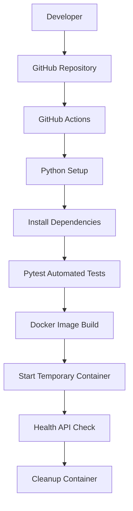
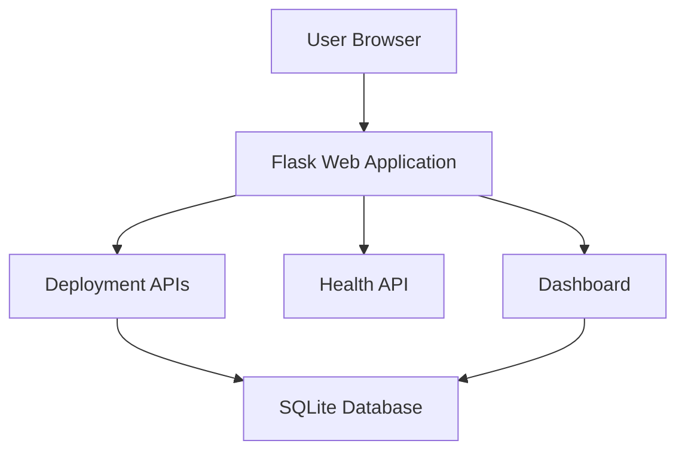

# System Architecture

## 1. CI Pipeline Architecture

## 2. Application Architecture

## 3. Architecture Explanation

The developer pushes application code to the GitHub repository. GitHub Actions automatically starts the CI workflow.

The workflow installs dependencies, executes automated tests, builds a Docker image, starts a temporary container, and verifies application health.

The Flask application provides a dashboard and API endpoints. SQLite stores deployment records used for deployment history, statistics, and failure analysis.

The GitHub Actions container is a temporary test environment. It is not a production deployment to a remote server.
